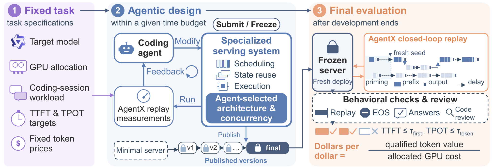
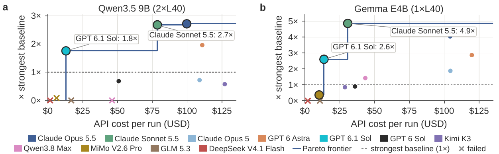

<div align="center">

### ServerBench: Can Coding Agents Build LLM Serving Systems?

[](serverbench/pyproject.toml)
[](LICENSE)

</div>

**ServerBench turns building an LLM serving system into a task a coding agent can be measured on.** An agent
(Claude Code or Codex) starts from a minimal Hugging Face server, one frozen deployment (a model, its GPUs, a
coding-session workload, p90 TTFT/TPOT targets and token prices), an offline container and an 8-hour clock.
It designs the scheduler, the KV cache, the batching, the kernels and the number of sessions it serves at
once, and publishes versions as it goes. When the clock runs out, the harness freezes the final version and
replays real agentic coding sessions against it with [AgentX](https://github.com/SemiAnalysisAI/agentx-harness)
for 1,800 s, on a workload seed no development run could draw, then checks its outputs privately. The score
is **dollars per dollar**: the token value of requests that meet the latency targets, over the GPU cost.

The best agent-built servers reach **2.7x** the strongest framework baseline (SGLang or vLLM at its best
operating point) on Qwen3.5 9B, **4.9x** on Gemma E4B and **1.8x** on Qwen3.8 27B INT4.

<p align="center">

</p>
<p align="center">

<br><em>Serving value relative to the strongest baseline against the agent's API cost per run (OpenRouter rates).</em>
</p>

## ✨ Key Features

- **No serving architecture in the harness.** The harness owns the task, the environment, the verification
  and the measurement; the agent owns every serving decision. SGLang and vLLM are measured on the same
  hardware as reference points and never copied into a workspace.
- **A verdict the agent cannot game.** The final replay draws an odd workload seed, development runs even
  ones. Outputs are checked against the plain checkpoint on held-out questions, with an end-of-sequence gate
  and replay fidelity, all host-side. The container's network is closed except for the model API. A
  submission that fails a check scores nothing.
- **Frozen, consistent tasks.** Each task fixes its model revision, hardware, workload, bars, prices and
  starter server, and is changed only through `taskctl`, which keeps every generated file in step.
- **Agent native.** Claude Code and Codex at any reasoning effort, each at its model's full context window
  (1M tokens for Claude and the open models, 872k for GPT models). A run that stops early resumes in the
  same workspace. Local Docker GPUs and Modal share one verdict path.

## 🚀 Installation

Requirements: Linux, NVIDIA GPUs matching the task (L40 / L40S, or Modal), Docker with the NVIDIA container
runtime, [`uv`](https://docs.astral.sh/uv/), the `claude` and/or `codex` CLI on `PATH`, and about 200 GB of
free disk for images, model weights and workspaces.

```bash
git clone --recursive https://github.com/Infini-AI-Lab/Server-Bench.git
cd Server-Bench

# 00 interpreters   01 preflight   02 offline wheelhouses and answer pool   03 agent images
bash serverbench/scripts/deploy/deploy.sh

. serverbench/scripts/env.sh                      # exports SERVERBENCH_PY
```

Each stage also runs on its own ([`serverbench/scripts/deploy/README.md`](serverbench/scripts/deploy/README.md)).
Stage the task's model in the Hugging Face cache first;
`"$SERVERBENCH_PY" serverbench/scripts/model_for_task.py serving_tasks/<task>` prints the pinned revision and
where it is expected. Agent credentials come from the operator's own Claude Code or Codex login, or from one
env file per model under `serverbench/artifacts/secrets/` (gitignored) for a model reached through an API key.

## ⚡ Quick Start

```bash
# prove the workspace boots, without launching an agent
bash serverbench/scripts/server_evolve/evolve-task.sh qwen3_5_9b_standard_2xL40 --hours 8 --dry-run

# one 8-hour evolve with Claude Code, detached
AGENT_CLI=claude AGENT_MODEL=claude-opus-5-5 AGENT_EFFORT=max GPU=auto setsid nohup \
    bash serverbench/scripts/server_evolve/evolve-task.sh qwen3_5_9b_standard_2xL40 \
        --hours 8 --stop timebox < /dev/null > evolve.log 2>&1 &

# the same with Codex
AGENT_CLI=codex AGENT_MODEL=gpt-6.1-sol AGENT_EFFORT=max GPU=auto setsid nohup \
    bash serverbench/scripts/server_evolve/evolve-task.sh gemma4_e4b_it_standard_1xL40 \
        --hours 8 --stop timebox < /dev/null > evolve.log 2>&1 &
```

`--hours` bounds the agent. After the deadline the harness runs the verdict (the 1,800 s replay plus the
private correctness stage), so the card stays busy about an hour longer. Then:

```bash
R=serverbench/evolve_space/evolve/<task, lower case>/<run id>
cat $R/SUMMARY.json                                            # terminal state, versions, verdict
"$SERVERBENCH_PY" evaluation_progress/record_run.py --run $R   # its row in evaluation_progress/<task>.csv
```

Every published version and its verdict land in `server_prototypes/<lineage>/`. The runbook is
[`serverbench/OPERATIONS.md`](serverbench/OPERATIONS.md).

## 🧪 Tasks

| task | model | hardware | brief | p90 TTFT / TPOT (ms) |
|---|---|---|---|---|
| `qwen3_5_9b_standard_2xL40` | Qwen/Qwen3.5-9B | 2x L40 | standard | 4,100.3 / 23.50 |
| `gemma4_e4b_it_standard_1xL40` | google/gemma-4-E4B-it | 1x L40 | standard | 2,526.9 / 121.71 |
| `qwen3_8_27b_int4_standard_2xL40` | RedHatAI/Qwen3.8-27B-INT4 | 2x L40 | standard | 10,298.8 / 48.38 |
| `qwen3_5_2b_standard_1xL40` | Qwen/Qwen3.5-2B | 1x L40 | standard | 2,707.8 / 12.19 |
| `qwen3_5_9b_instructed_2xL40` | Qwen/Qwen3.5-9B | 2x L40 | instructed | 4,100.3 / 23.50 |
| `gemma4_e4b_it_instructed_1xL40` | google/gemma-4-E4B-it | 1x L40 | instructed | 2,526.9 / 121.71 |
| `qwen3_5_2b_instructed_1xL40` | Qwen/Qwen3.5-2B | 1x L40 | instructed | 2,707.8 / 12.19 |
| `qwen3_5_9b_standard_modal_2xL40S` | Qwen/Qwen3.5-9B | 2x L40S (Modal) | standard | 10,000 / 60 |
| `gemma4_e4b_it_standard_modal_1xL40S` | google/gemma-4-E4B-it | 1x L40S (Modal) | standard | 3,000 / 80 |

The first three are the paper's deployments. An *instructed* task is identical to its *standard* twin except
for the brief, which adds serving guidance and a team of subagents. Bars are frozen before any agent sees the
task, from SGLang measured on the task's hardware; the Modal L40S bars are provisional. Each task also has a
short hash id that `evolve-task.sh` accepts. See [`serving_tasks/README.md`](serving_tasks/README.md).

## 📊 Results

| deployment | strongest baseline | best agent server | x baseline |
|---|---|---|---|
| Qwen3.5 9B (2x L40) | SGLang, 1.62 at c = 1 | Claude Opus 5.5, 4.40 at c = 16 | 2.72 |
| Gemma E4B (1x L40) | vLLM, 0.61 at c = 8 | Claude Sonnet 5.5, 2.97 at c = 32 | 4.87 |
| Qwen3.8 27B INT4 (2x L40) | vLLM, 1.47 at c = 1 | Claude Opus 5.5, 2.64 at c = 8 | 1.80 |

Values are latency-qualified dollars per dollar; `c` is the offered session concurrency. All 11 agent models,
both baselines, p90 latencies and API costs are in
[`evaluation_progress/leaderboard.csv`](evaluation_progress/leaderboard.csv), and the controlled comparisons
on frozen servers (capacity, draft length, replay feedback, successive versions, offered load) in
[`evaluation_progress/ablations.csv`](evaluation_progress/ablations.csv).

## 📂 Repository Layout

```
Server-Bench/
├── serverbench/          the harness
│   ├── harness/          lifecycle/ (evolve driver), final_validate/ (the verdict), serving_evolve/,
│   │                     kernel_evolve/, serverbench/ (console script)
│   ├── scripts/          evolve (the entrypoint), deploy/, server_evolve/, agent/, evidence/
│   ├── environments/     agent container images
│   ├── skills/           skill bundles for standard tasks
│   ├── skills_instructed/  skill bundles for instructed tasks
│   ├── docs/             design documentation
│   └── tests/            the CPU test suite
├── serving_tasks/        the tasks, plus _manage/ (taskctl), _modal/, _template/
├── evaluation_progress/  leaderboard.csv, ablations.csv, and the per-task ledgers runs write
├── experiments/          launchers for the experiment and ablation runs
├── server_prototypes/    published versions and verdicts, written by runs
├── harbor/               vendored Harbor, which composes every agent container
└── agentx-harness/       submodule: the pinned AgentX the verdict replays with
```

## 📚 Documentation

- [`serverbench/OPERATIONS.md`](serverbench/OPERATIONS.md): standing up a machine, running and reading an evolve
- [`serving_tasks/README.md`](serving_tasks/README.md) and [`serving_tasks/_manage/README.md`](serving_tasks/_manage/README.md): the tasks and `taskctl`
- [`serverbench/harness/final_validate/README.md`](serverbench/harness/final_validate/README.md): how the verdict measures and scores
- [`serverbench/docs/`](serverbench/docs/README.md): design pages for the evolve harness, containers, contracts and correctness

## 📜 License

ServerBench is released under the [Apache License 2.0](LICENSE). The vendored Harbor and the submodules keep
their own licenses. ServerBench builds on [Harbor](https://github.com/laude-institute/harbor) and
[AgentX](https://github.com/SemiAnalysisAI/agentx-harness), and its skill bundles include
[ncu-report-skill](https://github.com/mit-han-lab/ncu-report-skill) and
[KernelWiki](https://github.com/mit-han-lab/KernelWiki).
